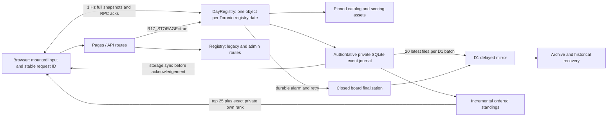

# R20 architecture and limits — 28 November 2026

Status: local candidate only. Production remains R19I. No R20 or R21 deployment is authorized by this document.

`worker/routes.ts` chooses the date object; practice uses the single `practice` object. `worker/registry.ts` still handles legacy/admin paths. A bootstrap may create identity; `/me` can also create identity. Neither is a production smoke endpoint. `/today` and leaderboard requests initialize the object and may prepare specials on a previously untouched day; even a GET is not automatically side-effect-free. The production inspection used existing authenticated admin metrics and aggregate SELECTs, never player endpoints or a golden-selection query.

Accepted events synchronously decide uniqueness/caps and append the full private resulting file; `storage.sync()` precedes the response. R20 rechecks close after scoring/validation. HTTP retry retains the original request ID; no claim is silently reissued with a new ID. Existing socket exponential backoff remains. Pending frontend RPCs now have an eight-request ceiling and return a retry response. Full snapshots retain the old wire shape; no deltas or new broadcast frequency.

R20's ordered vectors remove full-board sorting from accepted events. Inserts/removals shift O(n) elements, own rank is O(log n), top 25 is cached until an update, and finished-only score comparisons use a separate sorted distribution. Names are disambiguated within eligible claimers. Reference tests include ties, hidden/voided files, strike-only finishers, incomplete files, negative fixture totals and reconstruction. Active claim/golden counters update from accepted claims and rebuild on rare moderation/deletion. A broadcast serializes the shared day once, then separately serializes each viewer's leaderboard; private identity/replay/answer fields are never shared.

The journal adds one watermark checkpoint after a successful mirror campaign, not a counter per guess. Partial failures retain pending work; restart after a completed checkpoint avoids re-mirroring every player. A crash before the checkpoint permits harmless revision-guarded replay. The next retry is a durable alarm. The object's registry date is stored once so alarms following eviction finalize the original day. Closed boards are rebuilt before moderation flush and refreshed after withdrawal. The production residency interval is retained, with observable failure state; replacing it without hosted duration evidence would be speculative.

Memory still includes latest full private file snapshots, owners, identities, request replay bodies and whole-day journal replay. Restart reads every event. Sorted-vector shifts, per-viewer board JSON, unbounded server identity/admission caches, and full-history replay remain bottlenecks. Worker memory/CPU and actual hosted broadcast latency are unavailable in this run. Do not equate a Node microbenchmark with a Worker capacity test.

## Measurements and scaling triggers

`standings-benchmark.json` compares a full-reference board computation with incremental update plus exact own board in Node. At 10,000 fixture players its p95 was 5.243 ms versus 0.028 ms. This excludes network, durability, validation, Worker CPU limits and fan-out. It establishes an algorithm improvement, not 10,000 hosted players.

`local-load-50.json` exercises 50 local sockets and synchronized HTTP submissions, one contention winner, stable replay and mirror retention. It is a short Miniflare test, not a soak. The 500-player attempts failed with local connection resets (and one revealed the shared-network identity limit); the failure artifacts are retained. No hosted 500/1k/2k/5k/10k stage or ten-minute soak ran. The R17 historical run opened 500 sockets over 119.783 seconds and kept them until completion, but did not count actual peak active connections. Its 2,999 guesses / 123.563 seconds is about 24.3 guesses/s, not 500 synchronized guesses.

For any future hosted stage: zero lost acks, duplicate winners, cap or privacy violations; unexpected errors below 1%; claim p95 <=1s/p99 <=2s; visible standings p95 <=2s; steady healthy mirror lag <=120s. Stop on correctness or quota/backlog ceilings, or two consecutive 30-second windows over latency/error/lag ceilings. Budget setup, retries, drain, restore and monitoring before admission. Keep raw WebSocket messages distinct from billed request units. No supported hosted operating range has been established for this candidate.

## Further scaling design (not implemented)

First separate update fan-out from the single authoritative referee. A broadcaster may receive only an allowlisted public day/top-board snapshot with category ID and monotonically increasing sequence. Own rank remains authenticated. A gap or category mismatch requires a full resync; duplicate/old frames are ignored. Lost fan-out must never delay durable acknowledgement or permit a second winner.

Only measured referee saturation would justify answer sharding. A deterministic catalog-version/answer-ID shard can own uniqueness, but a separate player coordinator must atomically reserve one of three claims or five strikes, carry the same request ID, durably record commit/abort and recover partial failures. Global rank must preserve points, reachedAt and final user-ID tiebreak order. Neither optimistic shard-local caps nor compensated duplicate winners is acceptable. This needs a tested transaction protocol, a day-boundary migration, compatible rollback readers and unchanged committed selections. Shard counts are hypotheses. No coordination infrastructure was added.
